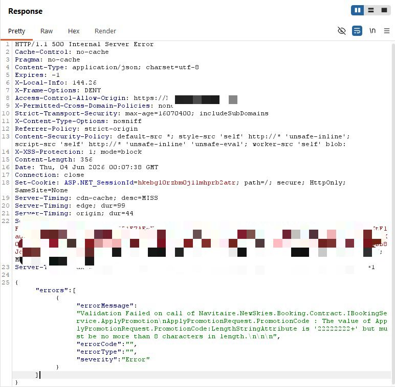
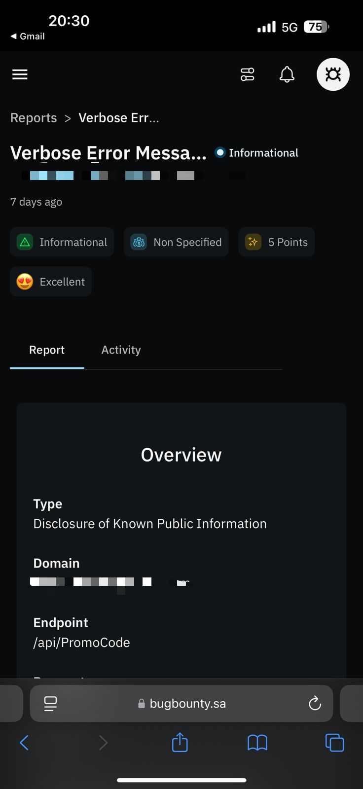

# Bug-Bounty-Reports
Bug bounty findings, vulnerability research, and responsible disclosure reports.

# Verbose Error Messages and Improper Error Handling in Promo Code API

**Platform:** BugBounty.sa  
**Vulnerability Type:** Information Disclosure  
**Severity:** Informational  
**Authentication Required:** No  
**Reproducibility:** 100%

---

## 1. Summary

The Promo Code API endpoint discloses sensitive internal implementation details when processing invalid user input.

Instead of returning a generic validation error, the application exposes backend technology information, internal service names, class names, and validation rules within the response body.

Additionally, the endpoint returns an `HTTP 500 Internal Server Error` for expected input validation failures, indicating improper exception handling and allowing attackers to gain insight into backend behavior.

This information disclosure may assist attackers during reconnaissance activities and facilitate more targeted attacks against the application infrastructure.

---

## 2. Vulnerability Details

| Field | Details |
|---|---|
| Endpoint | `/api/PromoCode` |
| Parameter | `promoCode` |
| Vulnerability | Verbose Error Messages / Information Disclosure |
| Severity | Informational |
| Authentication | Not Required |

The endpoint performs server-side validation on the supplied promo code value. When an invalid value exceeding the allowed length is submitted, the backend returns a verbose exception message containing internal implementation details.

### Information Disclosed

- Backend platform information.
- Internal service names.
- Internal class and request object names.
- Promo code length restrictions.
- Validation component details.

Furthermore, the application returns `HTTP 500 Internal Server Error` instead of an appropriate client-side validation response, such as `HTTP 400 Bad Request` or `HTTP 422 Unprocessable Entity`.

---

## 3. Proof of Concept (PoC)

### Step 1 – Intercept the Request

Intercept a request to the Promo Code API using **Burp Suite Repeater**.

### Step 2 – Send the Modified Request

Submit a promo code exceeding the allowed maximum length:

```http
POST /api/PromoCode HTTP/1.1
Host: XXXXXXX
Content-Type: application/json

{
  "promoCode": {
    "action": "add",
    "promoCode": "22222222+"
  }
}
```

### Step 3 – Observe the Response

The server responds with an HTTP 500 error and exposes internal implementation details:

```http
HTTP/1.1 500 Internal Server Error

{
  "errors": [
    {
      "errorMessage": "Validation Failed on call of [Internal Service] ApplyPromotionRequest.PromotionCode : The value of ApplyPromotionRequest.PromotionCode: LengthStringAttribute is '22222222+' but must be no more than 8 characters in length.",
      "errorCode": "",
      "errorType": "",
      "severity": "Error"
    }
  ]
}
```

### Step 4 – Analyze the Response

The following issues can be observed:

1. The API returns `HTTP 500` instead of an appropriate validation status code.
2. Internal service and class names are exposed.
3. Backend implementation details are disclosed.
4. Validation constraints, including the maximum promo code length, are revealed.

---

## 4. Evidence

### Burp Suite Request and Response



---

## 5. Requirements

- No authentication required.
- No special privileges required.
- Reproducible 100% of the time.

---

## 6. Impact

### 6.1 Technology Stack Disclosure

The response exposes information about the underlying backend platform and framework components.

An attacker may leverage this information to identify publicly known vulnerabilities, security advisories, or platform-specific attack vectors.

### 6.2 Internal Architecture Disclosure

The application reveals internal implementation details, including:

- Service interfaces.
- Request object names.
- Validation components.

This information assists attackers in mapping the application's internal structure and understanding backend workflows.

### 6.3 Business Logic Disclosure

The error message reveals validation rules associated with promo code processing, including maximum accepted length restrictions.

Knowledge of these constraints may help attackers optimize fuzzing strategies or enumeration activities.

### 6.4 Unauthenticated Information Disclosure

The issue can be triggered by any anonymous user without authentication, increasing the exposure surface and making automated reconnaissance easier.

---

## 7. Risk Rating

**Severity: Informational**

Although the vulnerability does not directly allow unauthorized access or data modification, it exposes internal application details that may facilitate further attacks and reduce uncertainty during reconnaissance.

---

## 8. Remediation

1. Replace verbose exception messages with generic user-facing error responses.
2. Avoid exposing internal class names, namespaces, method names, framework identifiers, or validation attributes in API responses.
3. Return appropriate HTTP status codes for validation failures:
   - `HTTP 400 Bad Request`
   - `HTTP 422 Unprocessable Entity`
4. Implement centralized exception handling to ensure unexpected errors are logged internally while returning sanitized responses to clients.
5. Review all API endpoints for similar verbose error disclosures and standardize secure error handling practices.

---

## 9. Tools Used

- Burp Suite Repeater

---

## 10. Disclosure

This report documents a security finding identified during authorized security testing and submitted through the BugBounty.sa platform.

---

## 11. Original Finding

The following screenshot shows the original finding where the vulnerability was identified.


